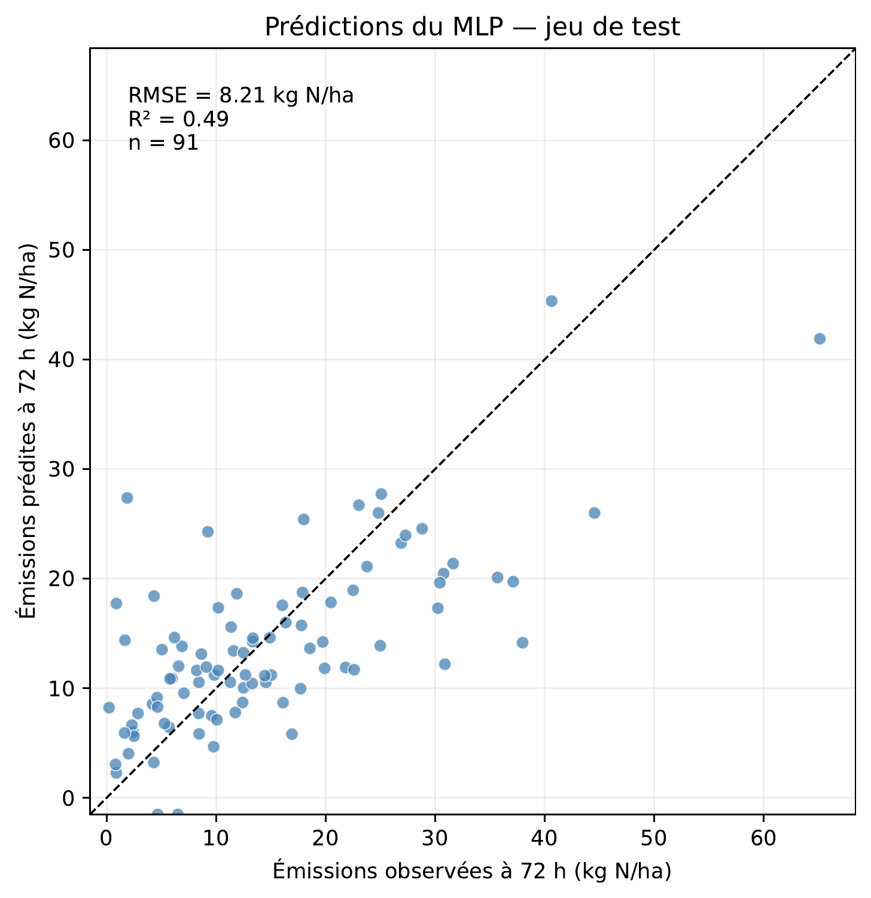

# Prédire les émissions d’ammoniac avec un petit réseau de neurones

Ce projet propose une démonstration de reproductibilité avec **renv** pour R et **pyenv** pour Python. Un petit réseau de neurones de type MLP est entraîné sur les données [ALFAM2](https://github.com/AU-BCE-EE/ALFAM2-data) pour prédire les émissions d’ammoniac après épandage. Les données utilisées correspondent à la [release 3.0](https://github.com/AU-BCE-EE/ALFAM2-data/releases/tag/v3.0).

R sert à préparer les données ; Python et PyTorch servent à entraîner et évaluer le modèle. Chaque observation correspond à une parcelle (`pmid`). Le modèle utilise huit variables continues et cinq variables catégorielles, représentées par des embeddings.

L’entraînement et la validation portent sur `e_rel_72`, la fraction du TAN appliqué émise à 72 heures. Pour l’évaluation sur le jeu de test, les prédictions sont multipliées par `tan_app` dans son unité d’origine, puis comparées aux émissions absolues `e_72`, en **kg N/ha**.

## Résultats

Les 603 observations sont réparties en trois sous-ensembles : 422 pour l’entraînement, 90 pour la validation et 91 pour le test. Le découpage utilise une graine fixée à `1`. Sur les 100 époques d’entraînement, le modèle retenu est celui de l’époque 48, qui minimise la MSE de validation.



La droite en pointillés représente une prédiction parfaite. 

| Métrique sur le jeu de test | Valeur | Unité |
| --- | ---: | --- |
| MAE — erreur absolue moyenne | 6,06 | kg N/ha |
| MSE — erreur quadratique moyenne | 67,44 | (kg N/ha)² |
| RMSE — racine de la MSE | 8,21 | kg N/ha |
| R² — coefficient de détermination | 0,49 | sans unité |
| MBE — biais moyen (prédit − observé) | −0,91 | kg N/ha |

Ces résultats correspondent à un seul découpage des données et servent d’illustration pour cette démonstration.

## Reproduire les résultats

### 1. Cloner le dépôt

```bash
git clone https://github.com/armandfavrot/my-project.git
cd my-project
```

Les commandes suivantes sont à exécuter depuis la racine du projet, sauf indication contraire. Le fichier de données utilisé par la préparation R doit être présent dans `data/ALFAM2-data-3.0/data-output/04/ALFAM2_plot.csv`.

### 2. Restaurer l’environnement R

Installer **R 4.4.1**, la version indiquée dans `renv.lock`, puis ouvrir R depuis la racine du projet :

```bash
R
```

Le fichier `.Rprofile` active automatiquement renv et propose son installation si nécessaire. Dans la console R, restaurer les versions des packages enregistrées dans le projet :

```r
renv::restore()
q(save = "no")
```

`renv` restaure les packages R ; la version de R elle-même doit être installée séparément. Voir la [documentation de renv](https://rstudio.github.io/renv/reference/restore.html).

### 3. Restaurer l’environnement Python

Installer et configurer [pyenv](https://github.com/pyenv/pyenv) ainsi que son extension [pyenv-virtualenv](https://github.com/pyenv/pyenv-virtualenv), puis exécuter :

```bash
pyenv install -s 3.12.3
pyenv virtualenv 3.12.3 ammonia_predictions
pyenv local ammonia_predictions
python3 -m pip install -r python_requirements.txt
```

La création de l’environnement avec `pyenv virtualenv` n’est nécessaire qu’une fois. Son nom, `ammonia_predictions`, correspond à celui enregistré dans `.python-version`. Les versions des packages Python sont fixées dans `python_requirements.txt`.

### 4. Préparer les données et entraîner le modèle

Depuis la racine du projet :

```bash
cd scripts
Rscript data_preparation.R
python3 training.py
```

`data_preparation.R` filtre les observations, traite les valeurs manquantes, encode les catégories et exporte `scripts/data.csv`. Le fichier `scripts/.Rprofile` permet d’utiliser l’environnement renv du projet depuis ce sous-dossier.

`training.py` effectue le découpage train/validation/test, standardise les variables continues avec les paramètres du train, entraîne le MLP et recharge le meilleur modèle pour l’évaluation finale. Les paramètres d’entraînement se modifient directement au début du script.

Les graines aléatoires sont fixées et les calculs déterministes activés. De légères différences peuvent néanmoins apparaître entre des environnements CPU et GPU ou des plateformes différentes.

## Fichiers produits

| Fichier | Contenu |
| --- | --- |
| `scripts/results/models/model_mlp_ammonia.pth` | Poids du meilleur modèle |
| `scripts/results/models/preprocessing.pkl` | Paramètres de standardisation et codage des catégories |
| `scripts/results/splits.csv` | Affectation des `pmid` aux trois sous-ensembles |
| `scripts/results/test_predictions.csv` | Observations et prédictions relatives et absolues du test |
| `scripts/results/summaries/test_metrics.json` | Métriques sur les émissions absolues |
| `scripts/results/summaries/training_summary_mlp_ammonia.json` | Durée et résumé de l’entraînement |
| `scripts/results/losses/` | Historique des pertes du train et de la validation |
| `scripts/images/observed_vs_predicted.pdf` | Figure au format PDF |
| `scripts/images/observed_vs_predicted.png` | Figure affichée dans ce README |
